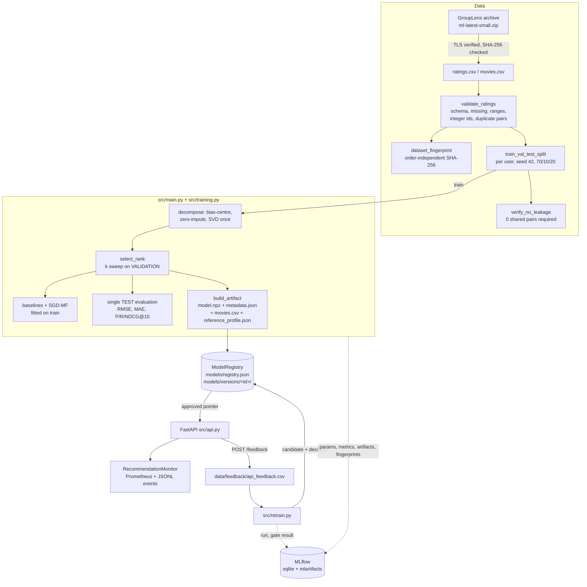

# Architecture

This document describes what is implemented in this repository, module by module.

## 1. Components and data flow

## 2. Model

Rating prediction (unchanged from the study):
`r̂_ui = μ + b_u + b_i + Σ_l σ_l U_k[u,l] V_k[i,l]` where `μ, b_u, b_i` come from the
additive bias decomposition of the **training** matrix and `U_k Σ_k V_kᵀ` is the
rank-k truncated SVD of the bias-centred, zero-imputed training matrix. Users or
items unseen in training fall back to the bias terms that exist (`mu + b_u`,
`mu + b_i` or `mu`). Ranking uses the unclipped score; predictions are clipped to
[0.5, 5.0].

Solver: full LAPACK SVD when `min(m, n) ≤ 3000` (latest-small: 610 × 8,578),
otherwise scikit-learn randomised SVD with `max(k) + 20` components (ML-1M). Both
were already used by the original study.

## 3. Model selection protocol

1. Split per user: 20 % test, 10 % validation, rest train (users with < 3 ratings stay in train).
2. Vocabulary (users, items) = training partition only.
3. SVD computed once on train; each k in `model.k_values` evaluated on validation.
4. k = argmin validation RMSE (ties: smaller k). `select_rank` never receives test data
   (enforced by `tests/test_integration.py::test_selection_never_sees_test`).
5. Baselines and SGD-MF are fitted on train with the selected k.
6. The test partition is evaluated once, after step 4.

## 4. Artifacts and registry

Each version directory holds `model.npz` (numeric arrays only, loaded with
`allow_pickle=False`), `metadata.json` (version id, k, metrics, dataset and split
SHA-256, environment, git commit, MLflow run id, serving policy, content SHA-256),
`movies.csv` (titles/genres for items in the vocabulary) and
`reference_profile.json` (monitoring reference). The loader rejects artifacts whose
content hash does not match.

`registry.json` holds the single `approved` pointer, the history of previously
approved versions and an event log (registered / approved / rejected / rollback with
the decision record). Writes are atomic (`os.replace`) under a lock file. Version ids
are `svd-k{k}-{dataset_sha[:8]}-{content_sha[:8]}`, so identical training yields an
identical id (verified: two runs on the same machine produced `svd-k20-fce385dc-c6b9d577`).

## 5. Serving

`api.py` builds the app with a factory (`create_app`) and loads the approved version
at startup. Without an approved model it still starts: `/health` returns 503 and
model endpoints answer 503, so orchestrators see the problem. Requests are logged as
JSON with request id, endpoint, status and latency (never request bodies).
`POST /model/reload` (token-protected) switches to a newly approved version without a
restart.

## 6. Monitoring

`monitoring.py`: Prometheus counters/histograms in a per-app registry, a rolling
window for drift, and a JSONL event log with salted-hash user ids. Input drift, prediction drift and
observed performance are reported separately (see MONITORING.md).

## 7. Retraining

`retrain.py`: validated feedback → deterministic hash split into feedback-train /
feedback-validation → candidate trained on base-train + feedback-train with k chosen
on validation → approved model scored on the same validation data → explicit gate →
register + promote or reject; the previous model stays for rollback (see RETRAINING.md).

## 8. Configuration

`config.yaml` (all parameters) + environment overrides in `settings.py`
(`SVD_MODEL_DIR`, `SVD_DATA_DIR`, `MLFLOW_TRACKING_URI`, ...; see `.env.example`).
