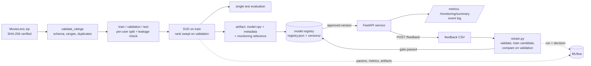

# SVD-Based Collaborative Filtering: Movie Recommendation Service

A movie recommender built on truncated **Singular Value Decomposition** of the
MovieLens rating matrix, extended from an academic study into a reproducible,
tested service: leakage-free evaluation, a FastAPI inference API, MLflow experiment
tracking, live monitoring with drift checks, a gated retraining workflow, Docker
packaging and GitHub Actions CI.

> **Methodology correction (Nov 2026).** The original pipeline selected the SVD rank
> on the **test set** and reported the score on that same set. It now uses a
> **train / validation / test** split: rank is chosen on validation only and the test
> set is evaluated once. The historical numbers are kept and labelled in
> [`outputs/HISTORICAL_RESULTS.md`](outputs/HISTORICAL_RESULTS.md).

> **Dataset licence.** MovieLens may be used for research only; **commercial or
> revenue-bearing use requires written permission from GroupLens** (University of
> Minnesota). See [DATA_CARD.md](DATA_CARD.md) before any commercial deployment.

---

## 1. Problem and objectives

Predict how a user would rate movies they have not seen, and recommend the top-N.

* Learn user and item latent factors from sparse explicit ratings (0.5–5.0 stars).
* Measure rating accuracy (RMSE, MAE) and top-N quality (Precision/Recall/NDCG@10,
  catalogue coverage) against honest baselines, on data never used for selection.
* Serve recommendations through an API, monitor it, and retrain safely.

## 2. Results (corrected methodology, MovieLens latest-small)

100,836 ratings, 610 users, 9,724 movies. Per-user split 70 / 10 / 20 (seed 42):
70,579 train, 10,093 validation, 20,164 test ratings; zero shared (user, movie) pairs.

**Rank selection on validation** (`outputs/corrected/k_sweep_validation.csv`):

| k | 5 | 10 | **20** | 50 | 100 | 150 | 200 |
|---|---|---|---|---|---|---|---|
| validation RMSE | 0.8755 | 0.8743 | **0.8729** | 0.8767 | 0.8798 | 0.8817 | 0.8820 |

**Final test evaluation of the selected configuration** (evaluated once,
`outputs/corrected/results_test.csv`):

| Model (fitted on train) | Test RMSE | Test MAE | P@10 | R@10 | NDCG@10 | Coverage |
|---|---|---|---|---|---|---|
| Global mean | 1.0442 | 0.8266 | – | – | – | – |
| User mean | 0.9435 | 0.7350 | – | – | – | – |
| Item mean | 0.9782 | 0.7544 | – | – | – | – |
| User + item bias | 0.8943 | 0.6834 | 0.0028 | 0.0009 | 0.0024 | 0.005 |
| **SVD k = 20 (served)** | **0.8853** | **0.6754** | 0.0103 | 0.0022 | 0.0109 | 0.029 |
| SGD-MF k = 20 (comparison) | 0.8737 | 0.6708 | – | – | – | – |
| Most popular | – | – | **0.1108** | **0.0923** | **0.1470** | 0.019 |

How to read this honestly:

* SVD improves rating prediction over every bias baseline (test RMSE 0.8853 vs
  0.8943 for user+item bias). SGD-MF, which fits only observed ratings, is better
  still (0.8737), consistent with the original study's finding.
* **For top-10 recommendation, a plain most-popular list beats the SVD model by a
  wide margin** under this offline protocol (NDCG@10 0.147 vs 0.011). RMSE-optimised
  factorisation with unregularised item biases favours niche items. This was checked
  on validation before any test evaluation; tightening the item-support threshold
  narrows the gap but never closes it. The serving policy (minimum 5 training ratings
  per item) was fixed a priori and not tuned to improve these numbers.
* 896 test ratings (4.4 %) concern movies that never appear in training; they are
  predicted with an explicit bias-only fallback and are included in every metric.

MovieLens 1M cross-check (corrected method, `outputs/corrected/ml1m/`): k = 20 chosen on
validation; test RMSE 0.9013 / MAE 0.7070 versus 0.9318 / 0.7341 for user + item bias.

Historical (test-selected) results: k = 10, RMSE 0.8812. They are optimistically
biased and not comparable; see [`outputs/HISTORICAL_RESULTS.md`](outputs/HISTORICAL_RESULTS.md).

Alternative dataset (separate pipeline, `outputs/external/movietweetings/`): MovieTweetings
(MIT-licensed by its author; commercial use still needs legal review). k = 5 chosen on
validation (edge of the grid); test RMSE 0.6930 vs 0.6986 for user + item bias (0.5–5 scale);
most popular again far ahead on NDCG@10 (0.0568 vs 0.0039). See
[`docs/MOVIETWEETINGS_EVALUATION.md`](docs/MOVIETWEETINGS_EVALUATION.md) and
[`docs/DATASET_LICENSING.md`](docs/DATASET_LICENSING.md).

## 3. Architecture



Details: [ARCHITECTURE.md](ARCHITECTURE.md).

## 4. Repository structure

```
├── src/
│   ├── main.py            corrected training pipeline (train/val/test, registry, MLflow)
│   ├── run_ml1m.py        cross-dataset check on MovieLens 1M (corrected method)
│   ├── data_loader.py     download + checksum, validation, fingerprint, 3-way split
│   ├── training.py        decomposition + validation rank selection (shared core)
│   ├── svd_model.py       SVD model, Eckart-Young, safe (pickle-free) persistence
│   ├── evaluation.py      RMSE/MAE, baselines, fallback-aware evaluation
│   ├── ranking.py         Precision/Recall/NDCG@K, coverage
│   ├── recommender.py     serving artifact: build, load, recommend, cold start
│   ├── registry.py        versioned registry with explicit approval and rollback
│   ├── tracking.py        MLflow wrapper (local SQLite by default)
│   ├── monitoring.py      Prometheus metrics, drift (PSI), delayed-label performance
│   ├── retrain.py         gated retraining workflow
│   ├── api.py             FastAPI application
│   ├── settings.py        config.yaml + environment overrides
│   ├── logging_utils.py   JSON / text structured logging
│   └── visualizations.py  figures
├── scripts/               synthetic data, demo model, traffic simulator, feedback generator
├── tests/                 156 tests (unit, API, integration, MLflow, monitoring, retraining)
├── outputs/corrected/     corrected results, split manifest, plots
├── outputs/               HISTORICAL results of the previous method (labelled)
├── docs/evidence/         logs captured during the acceptance run
├── report/, presentation/ original LaTeX report and slides (historical numbers)
├── certs/                 public GroupLens intermediate certificate (TLS chain fix)
├── config.yaml            all parameters
├── Dockerfile, docker-compose.yml, .env.example
└── requirements*.txt
```

## 5. Installation

Python 3.12 or 3.13 (the pinned NumPy 2.5 requires Python ≥ 3.12).

```bash
python -m venv .venv && source .venv/bin/activate      # Windows: .venv\Scripts\activate
pip install -r requirements-dev.txt                       # or requirements.txt without test tools
```

Configuration lives in `config.yaml`; deployment overrides in `.env` (copy
`.env.example`). The MovieLens archive is downloaded on first run, verified against
its SHA-256 and extracted to `data/` (not committed).

## 6. Train and evaluate

```bash
python src/main.py --approve --approval-reason "reviewed validation selection and test result"
```

Writes `outputs/corrected/` (metrics, sweep, split manifest, data-quality report,
plots), registers a model version under `models/` and records an MLflow run.
Without `--approve` the version is registered but **not** served. Useful flags:
`--no-plots`, `--no-mlflow`, `--no-register`, `--ratings <csv>`.

MovieLens 1M cross-check: `python src/run_ml1m.py` (writes `outputs/corrected/ml1m/`).

MovieTweetings (separate registry `models_external/movietweetings/`, output
`outputs/external/movietweetings/`, MLflow experiment `svd-movietweetings`):
`python src/run_movietweetings.py [--approve --approval-reason "..."]`; gated retraining with
`--retrain-feedback <csv> [--dry-run]`, rollback with `--rollback`.

## 7. API

```bash
uvicorn api:app --app-dir src --host 0.0.0.0 --port 8000
```

Swagger UI: <http://localhost:8000/docs>. Endpoints: `GET /health`,
`GET /model/info`, `GET /recommendations/{user_id}?n=10`, `POST /recommendations`,
`POST /predict`, `POST /feedback`, `GET /metrics`, `GET /monitoring/summary`,
`POST /model/reload` (only with `SVD_ADMIN_TOKEN`). Real request/response examples
captured from the running service: [API_DOCUMENTATION.md](API_DOCUMENTATION.md).

```bash
curl -s "http://localhost:8000/recommendations/1?n=3"
```
```json
{"user_id":1,"model_version":"svd-k20-fce385dc-c6b9d577","strategy":"svd","known_user":true,"cold_start":false,
 "n_requested":3,"n_returned":3,"items":[{"rank":1,"movie_id":3347,"title":"Never Cry Wolf (1983)",
 "genres":["Adventure","Drama"],"score":5.355387,"predicted_rating":5.0}, "..."]}
```

Unknown users receive the most-popular fallback (`"strategy": "popularity_fallback"`,
`"cold_start": true`). Movies the user already rated are never recommended.
Titles and genres come from MovieLens `movies.csv` joined on `movieId`.

## 8. Docker

```bash
docker compose build api
docker compose --profile tools build trainer
docker compose --profile tools run --rm trainer   # download, train, evaluate, approve into the 'models' volume
docker compose up -d api                          # http://localhost:8000/docs
docker compose logs -f api
docker compose down
```

CPU only; 1 GB RAM is ample for the API (image 423 MB). The API is published on
127.0.0.1 only by default (`API_BIND`), runs as uid 10001 with all capabilities dropped and
mounts the registry read-only. See [DEPLOYMENT.md](DEPLOYMENT.md) and [SECURITY.md](SECURITY.md).

## 9. MLflow

Runs are recorded in a local SQLite database (`mlflow.db`) with artifacts in
`mlartifacts/`; no server or credentials needed.

```bash
mlflow ui --backend-store-uri sqlite:///mlflow.db --port 5000     # http://localhost:5000
```

Each run logs parameters (k grid, selected k, seed, split fractions, SGD settings),
the validation sweep, validation and test metrics, dataset and split fingerprints,
the git commit and the model artifact. Approved versions carry the MLflow alias
`champion`. Set `MLFLOW_TRACKING_URI` to use a remote server.

## 10. Monitoring

`GET /monitoring/summary` and Prometheus `GET /metrics` report request counts,
latency, errors, cold-start and unknown-user rates, recommendation popularity,
**input drift** and **prediction drift** (PSI against the training reference) and,
only once enough `POST /feedback` ratings exist, **observed RMSE/MAE**. User ids are
pseudonymised (salted SHA-256) in the event log. See [MONITORING.md](MONITORING.md).

## 11. Retraining

```bash
python src/retrain.py --feedback data/feedback/api_feedback.csv --dry-run   # evaluate, change nothing
python src/retrain.py --feedback data/feedback/api_feedback.csv             # promote only if the gate passes
python src/retrain.py --rollback --reason "..."                             # restore the previous model
```

New ratings are validated, split into feedback-train / feedback-validation, a
candidate is trained and compared with the approved model **on validation data**
using explicit criteria; the test set is never read. See [RETRAINING.md](RETRAINING.md).

## 12. Testing and CI

```bash
pytest                         # 156 tests, ~30 s, synthetic fixtures, no network
ruff check src tests scripts
```

GitHub Actions (`.github/workflows/ci.yml`) runs lint and tests on Python 3.12 and
3.13, builds the Docker image and smoke-tests inference inside a container; a
real-data pipeline job (fresh MovieLens download, SHA-256 check, full corrected pipeline,
methodology assertions) runs on pull requests, on `main`, on the delivery branch and on
manual dispatch. See [TESTING.md](TESTING.md).

## 13. Limitations

* **Licence**: MovieLens is research-only. Commercial use requires written permission from
  GroupLens (the University of Minnesota offers a negotiated commercial licence) or a
  commercially licensed / client-owned dataset. MovieTweetings is MIT-licensed by its author
  but derived from tweets and linkable to Twitter accounts; legal review is required
  ([`docs/DATASET_LICENSING.md`](docs/DATASET_LICENSING.md)).
* **Security**: no authentication, TLS or rate limiting in the application; these are
  deployment prerequisites ([SECURITY.md](SECURITY.md)).
* Offline top-N quality of the served SVD model is far below a most-popular list
  (section 2). Use online A/B testing before relying on personalised rankings, and
  consider ranking-oriented models (implicit ALS, BPR) as future work.
* Random per-user splits ignore time; a temporal split would be more realistic.
* Dense SVD with zero imputation scales to latest-small and 1M; larger catalogues
  need sparse/iterative solvers (randomised SVD is already used above 3,000 columns).
* Cold start for new users is popularity-only; new movies need ratings before they
  can be recommended (minimum 5 training ratings).
* Drift reference distributions assume request users resemble training users;
  recalibrate the reference from production traffic once available.
* The retraining demonstration used **synthetic** feedback; real retraining needs
  real observed ratings.

## 14. Future improvements

Ranking-oriented training objectives, temporal evaluation, regularised biases,
hybrid content features for cold start, a persistent metrics store (Prometheus +
Grafana), authentication on the API, and scheduled retraining once real feedback
volume is available.

## Citation

F. Maxwell Harper and Joseph A. Konstan. 2015. The MovieLens Datasets: History and
Context. ACM Transactions on Interactive Intelligent Systems 5(4).
